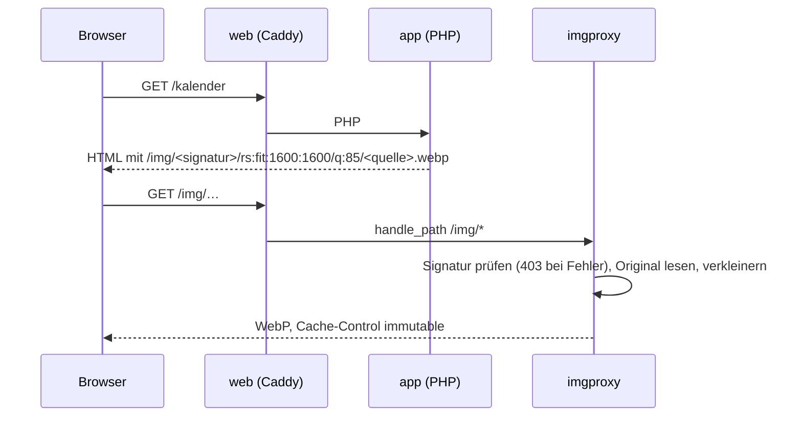
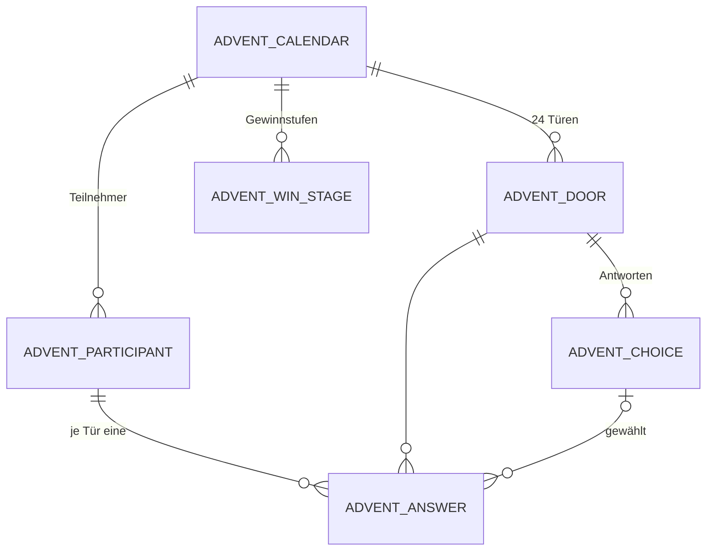

# Aufbau

## Dienste

| Dienst | Image | Aufgabe |
|---|---|---|
| `web` | `hub-web:prod` (Caddy 2.11, gebaut) | einziger Host-Port `10.0.0.2:8197`. Liefert die kompilierten Assets, leitet `/img/*` an imgproxy weiter, alles andere an PHP |
| `app` | `hub-app:prod` (PHP 8.5 FPM, gebaut) | Symfony. Schreibt Uploads in den Medienordner |
| `imgproxy` | `ghcr.io/imgproxy/imgproxy:v4.0.25` | rechnet Bildgrößen auf Abruf, liest den Medienordner nur lesend, kein Host-Port |
| `migrate` | wie `app` | `doctrine:migrations:migrate` bei jedem Deploy, beendet sich danach |
| `database` | `mysql:8.4.13` | Datenbank `hub` |
| `backup` | `mysql:8.4.13` | Dump auf Abruf (Profil) nach `/srv/hub/backups` |

## Domains und Routen

Die Startseite (`/`, `/projekte`) antwortet **nur** auf `wh-company.com` und `www.wh-company.com`. Die Host-Liste
steht als Parameter `app.main_host_pattern` in `config/services.yaml`; im Dev kommen `localhost` und `127.0.0.1`
dazu. Die übrigen Routen von hub hängen an keiner Domain – außer der Journey.

| Domain | Was |
|---|---|
| `wh-company.com`, `www.wh-company.com` | Startseite, Projekte und alle Tools ohne eigene Domain |
| `kresh.wh-company.com` | **nur** die Journey (Geburtstags-Journey für Kristin, früher Repo advent) |

**Journey** (`src/Tool/Journey`, Templates `templates/tool/journey`): Ihre Routen haben
`host: '%app.journey_host%'` (`kresh.wh-company.com`, im Dev `kresh.localhost` → <http://kresh.localhost:8197/>).
`JourneyHostListener` sorgt dafür, dass es auf dieser Domain nichts anderes gibt: Jede andere Route (`/admin`,
`/login`, `/kalender`, …) ist dort 404, bevor die Firewall läuft – also ohne Sitzung, Cookie oder Login-Weiterleitung.
Erlaubt bleiben `/healthz` und lokal (ohne imgproxy) `/media/journey/…`. Alle Antworten der Domain tragen
`X-Robots-Tag: noindex, nofollow` (PHP; für `/img` und `/assets` der Caddy im Container), die Seite zusätzlich
`<meta name="robots" content="noindex">`.

- Keine Benutzer, keine Datenbank: Texte, Rätsel und Lösungen stehen in `SlideProvider` bzw. den Partials.
- Prüf-Routen (nur POST; fremde Seiten – `Origin` bzw. `Sec-Fetch-Site` passt nicht – bekommen 403):
  `/api/sauna-choice`, `/api/kennzeichen-check`, `/api/kniffel-roll`, `/api/run-code`.
- `/testing` (alles ohne Scroll-Sperre) gibt es nur in `APP_ENV=dev`.
- Bilder aus dem Medienordner `journey/` über imgproxy (Preset `journey`). Tailwind 3.4.17 (wie früher das CDN)
  wird nur für die Journey gebaut: lokal `make tailwind`, im Image eine eigene Debian-Stufe (das v3-Binary gibt es
  nicht für Alpine). GSAP 3.12.2 liegt unverändert unter `assets/journey/`.

| Pfad | Was | Zugang |
|---|---|---|
| `/` | Startseite (vier Streifen) | alle, nur Hauptdomain |
| `/projekte` | Liste aller Projekte | alle (BetAI nur angemeldet) |
| `/kalender`, `/kalender/{jahr}/{monat}` | Foto-Kalender | alle |
| `/calendar/overview.html`, `/calendar/detail/{month}.html` | alte Adressen → 301 auf `/kalender…` | alle |
| `/advent/{token}` | Adventskalender eines Teilnehmers | wer den Link hat |
| `/admin/advent/{id}/vorschau` | alle Türen offen, nichts wird gespeichert | Admin |
| `/media/{pfad}` | Original aus dem Medienordner (Videos; lokal alles) | öffentliche Ordner; `advent/`, `journey/` nur Admin |
| `/img/…` | verkleinerte Bilder (imgproxy, signiert) | wer die signierte URL hat |
| `/admin`, `/login` | EasyAdmin, Anmeldung | Admin |
| `/healthz` | Healthcheck bis zur Datenbank | jede Domain |
| `kresh.wh-company.com/` | Journey | alle, nur diese Domain |
| `kresh.wh-company.com/api/…` | Prüf-Routen der Journey (POST) | nicht von fremden Seiten |

Die Anmeldung ist nirgends verlinkt außer über das Logo der Startseite.

**Was mehrere Domains nicht behindert:**
- `trusted_hosts` ist bewusst nicht gesetzt. Der VPS-Caddy leitet nur bekannte Domains weiter, und eine feste
  Liste würde die Healthchecks (`127.0.0.1`, `10.0.0.2`) und jede neue Tool-Domain brechen.
- Das Session-Cookie gilt nur für die eigene Domain. Admin-Login auf wh-company.com, Advent-Teilnehmer brauchen
  keine Sitzung.
- Der Caddy im Container antwortet auf jeden Host (`SERVER_NAME=":80"`). Nur `X-Robots-Tag` hängt am Host der Journey
  (`JOURNEY_HOST`, Standard `kresh.wh-company.com`).

## Gemeinsamer Medienordner und imgproxy

- `src/Media/MediaStorage.php`: Ordner `var/media` (in Produktion das Volume) mit Prüfung der Pfade gegen `..`.
- `src/Media/MediaUrlGenerator.php`: Presets `logo`, `admin`, `tile`, `thumb`, `card`, `photo`, `advent` (Breiten
  für `srcset`). Twig: `media_url(pfad, 'preset')`, `media_srcset(…)`, `media_original(…)`.
- `src/Media/Imgproxy/ImgproxyUrlSigner.php`: übernommen aus digital-frame-server. Ohne `IMGPROXY_KEY`/`_SALT`
  (lokal) gibt es kein imgproxy; dann liefert `MediaController` die Originale.
- Uploads in EasyAdmin über `MediaImageField`: zufällige Dateinamen im Unterordner des Tools, gespeichert wird
  der Pfad relativ zum Medienordner.

## Adventskalender

- **Freischaltung** nur in `DoorUnlockPolicy`: Tür n öffnet am Startdatum + (n − 1) Tage um 0 Uhr in der Zeitzone
  des Kalenders (Standard Europe/Berlin) und bleibt danach offen, auch nach dem 24. und in Folgejahren. Getestet
  in `tests/Tool/Advent/DoorUnlockPolicyTest.php`, inklusive Zeitumstellung und anderer Zeitzonen.
- **Spielregeln** in `AdventGame`: nur offene Türen, nur Antworten dieser Tür, genau eine Antwort je Tür (zusätzlich
  per Unique-Index). Punkte werden beim Antworten festgehalten.
- **Oberfläche** ist die Live Component `AdventBoard`. Ihre Props sind nur lesbar und signiert, jede Aktion prüft
  erneut auf dem Server. Antworttexte, Reaktionen und Bilder erscheinen erst nach dem Antworten. Bilder von
  Antworten gibt es nur über signierte imgproxy-URLs, `/media/advent/…` sieht nur der Admin.
- **Zugang**: Der Admin legt Teilnehmer an. Jeder bekommt einen Link `/advent/<32 Hex-Zeichen>`, ohne Konto.
  „Neuer Link“ im Admin macht den alten ungültig.
- **Eigene Domain**: Feld „Eigene Domain“ am Kalender. Die Teilnehmer-Links zeigen dann dorthin, und `/` auf
  dieser Domain begrüßt (Routen-Bedingung `AdventHosts`). Nötig sind nur DNS und ein Eintrag im VPS-Caddy, kein Code.
- **Inhalte** in EasyAdmin oder als YAML: `app:advent:import` (Beispiel `docs/advent/beispiel.yaml` im Repo).

## Fotokalender

Tabellen `fotokalender_calendar` → `fotokalender_month` (Monat, Motto, Titelbild) → `fotokalender_photo`.
Mehrere Fotos auf einmal: EasyAdmin → Monatsblätter → „Fotos hochladen“. Einen Kalender aus Ordnern im
Medienordner anlegen: `app:fotokalender:import --year=2022`.

## Startseite

Die Einträge sind `Project`-Datensätze (EasyAdmin → Projekte):
- „Groß auf der Startseite“ macht einen Streifen daraus, sortiert nach Position.
- „Nur angemeldet“ blendet einen Eintrag für Gäste aus.
- Bild und optional Video kommen aus dem Medienordner `projekte/`.
- `app:projects:seed` gleicht die festen Einträge ab: Debes, Nimbus, Secret Santa, About, ESC, BetAI.

Das Logo liegt als SVG in `assets/images/brand/`; es wird mit `docs/brand/make_logo.py` im Repo erzeugt.
