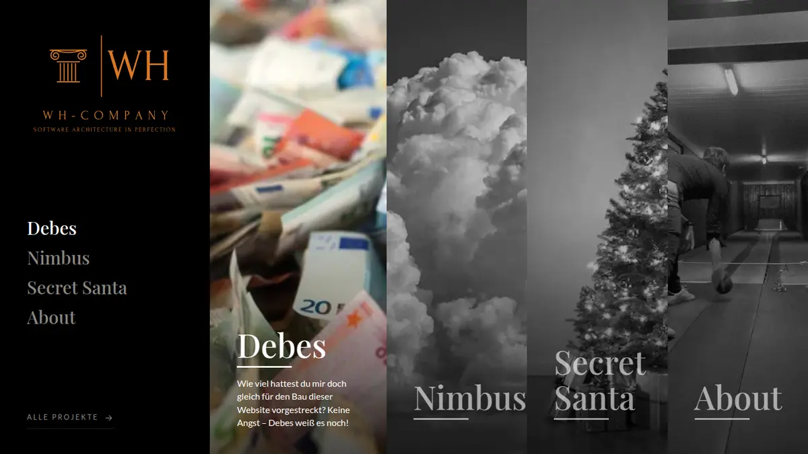
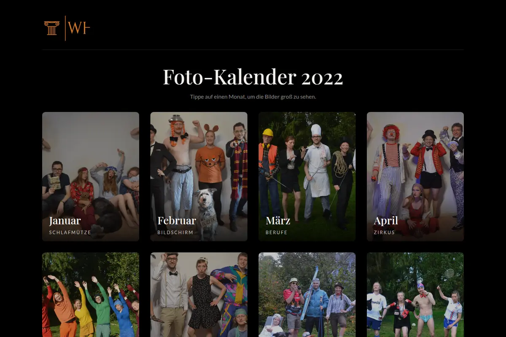
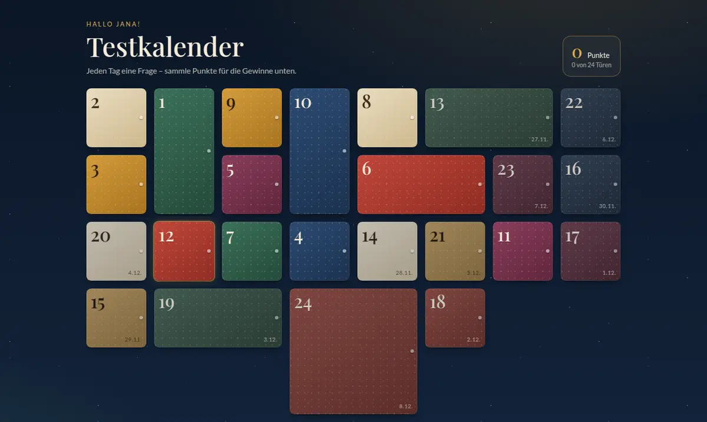
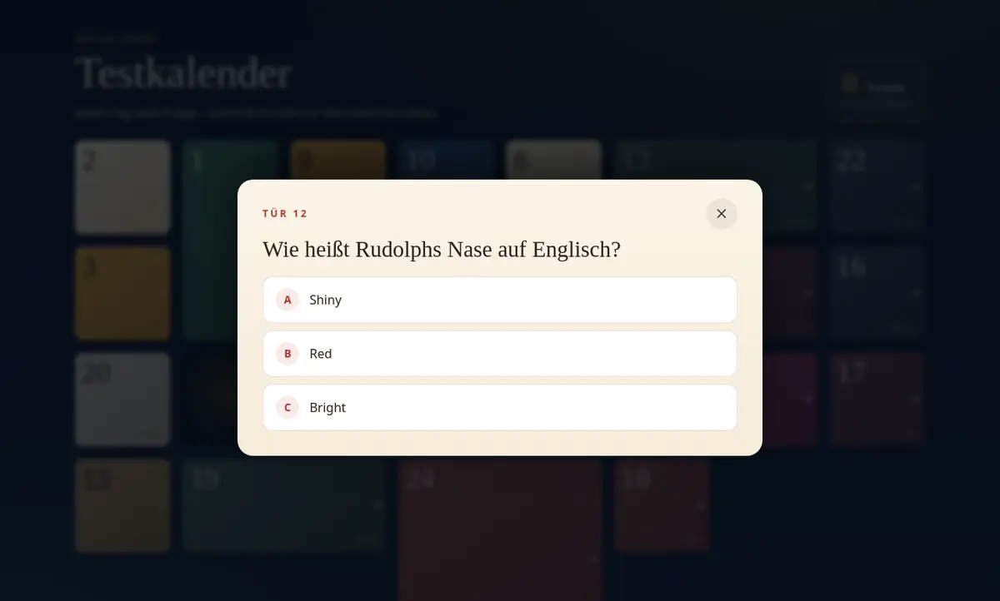
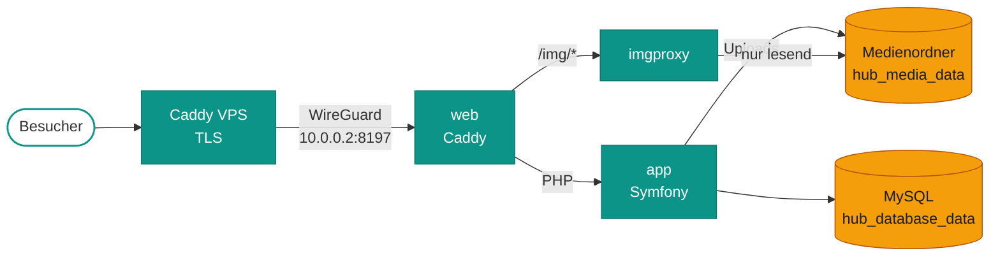

# Hub – WH-Company

Die <em>Zentrale</em> von WH-Company – Startseite, Fotokalender und <em>Adventskalender</em> in einer App.

Eine schlichte Startseite führt zu Debes, Nimbus und Secret Santa. Dahinter laufen kleine Tools mit gemeinsamer Anmeldung, gemeinsamer Datenbank und einem gemeinsamen Medienordner.

<ol>
<li data-title="Startseite" data-icon="image" data-badges="schwarz-weiß|farbig beim Zeigen|fürs Handy">

Vier Streifen wie auf der alten wh-company.de: grau, bis man darauf zeigt. „About“ ist ein kurzes Video. Alle weiteren Projekte liegen hinter „Alle Projekte“, die Anmeldung hinter dem Logo.

</li>
<li data-title="Foto-Kalender" data-icon="calendar" data-badges="9 Monate|38 Fotos|Admin-Upload">

Der Kalender 2022 mit Kippkarten je Monat und einer Galerie zum Wischen. Neue Fotos lädt der Admin hoch, gleich mehrere auf einmal.

</li>
<li data-title="Adventskalender" data-icon="star" data-badges="24 Türen|eigener Link|ohne Konto">

Jeden Tag springt eine Tür auf, dahinter eine Quizfrage. Jeder Teilnehmer hat seinen Link, seinen Fortschritt und seine Punkte.

</li>
<li data-title="Quiz hinter der Tür" data-icon="sparkle" data-badges="Antwort A–C|Bild/Video|Gewinnstufen">

Die Tür schwingt am Scharnier auf, dann kommt die Frage. Nach der Antwort folgen eine Reaktion mit Bild oder YouTube-Video, Punkte und mehr freigeschaltete Gewinne.

</li>
<li data-title="Bilder in jeder Größe" data-icon="bolt" data-badges="imgproxy|WebP|signiert">

Originale liegen einmal im Medienordner. imgproxy rechnet die passende Größe, und nur signierte Adressen funktionieren.

</li>
<li data-title="Pflege im Admin" data-icon="edit" data-badges="EasyAdmin|Vorschau|YAML-Import">

Projekte, Kalenderblätter, Türen mit Antworten, Gewinnstufen und Teilnehmer pflegt der Admin in EasyAdmin, mit einer Vorschau aller Türen.

</li>
</ol>
<ul class="hl-showcase__tags"><li>BetAI</li><li>ESC Voting</li><li>gemeinsame Anmeldung</li><li>Logo als SVG</li><li>Schriften selbst gehostet</li><li>Türen serverseitig freigeschaltet</li><li>Europe/Berlin</li><li>nach dem 24. alles offen</li><li>Live Components</li><li>eigene Domain je Tool möglich</li><li>alte Adressen leiten um</li></ul>

Symfony-App auf **abyss** (Komodo-Stack `hub`), erreichbar unter **wh-company.com** (www leitet um). Sie bündelt
die Startseite von WH-Company und mehrere kleine Tools unter `src/Tool/<Name>/`: **Fotokalender**,
**Adventskalender**, **BetAI** (nur angemeldet) und **ESC Voting**. Die Anmeldung braucht nur der Admin.
Teilnehmer des Adventskalenders kommen über ihren persönlichen Link.

  
<b>4</b>Dienste dauerhaft web, app, imgproxy, database

  
<b>2</b>Dienste auf Abruf migrate, backup

  
<b>4</b>Tools Fotokalender, Advent, BetAI, ESC

  
<b>31</b>Tabellen eine Datenbank

  
<b>1</b>Medienordner Volume hub_media_data

-   :material-account-group-outline:{ .lg } **Für wen**

    ---

    Besucher von wh-company.com (Startseite, Fotokalender), eingeladene Teilnehmer eines Adventskalenders
    und der Admin, der alles pflegt.

-   :material-shield-lock-outline:{ .lg } **Wer was darf**

    ---

    Gäste sehen Startseite, „Alle Projekte“ (ohne BetAI) und den Fotokalender. Teilnehmer sehen nur ihren
    Kalender. `/admin` und die Vorschau sind nur für `ROLE_ADMIN` erreichbar.

-   :material-image-multiple-outline:{ .lg } **Bilder**

    ---

    Uploads landen im Medienordner (`advent/`, `fotokalender/`, `projekte/`, `bet_ai/logos/`), ausgeliefert über
    imgproxy. Details: [Daten](daten.md).

Weiter: [Aufbau](aufbau.md) · [Betrieb](betrieb.md) · [Daten](daten.md) · [Probleme](probleme.md)
